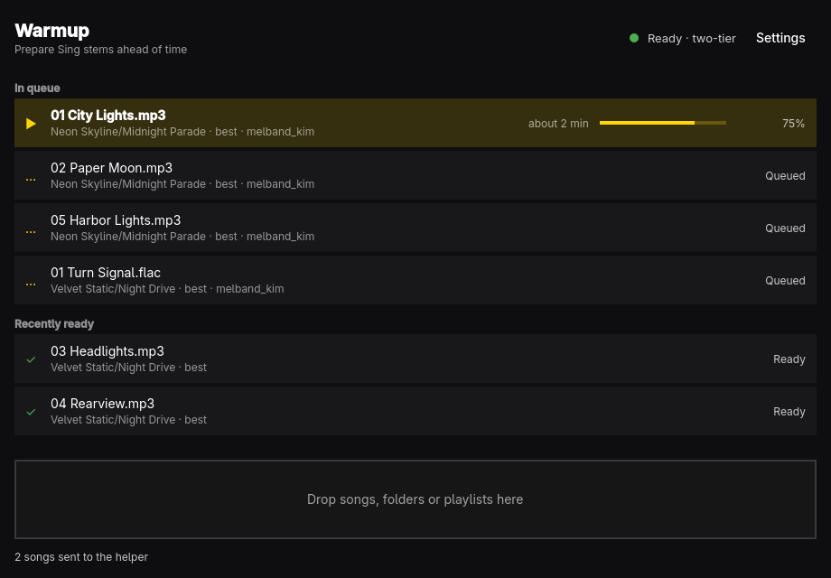

# Warmup



Warmup prepares [Narjo Sing](https://github.com/ayumpo/narjo-sing-helper)
stems ahead of time. Drop songs, folders, or playlists onto the window and
your self-hosted helper separates each song into vocals and instrumental in
the background — so the next time you tap the microphone in Narjo, the song
starts in Sing within a second instead of separating for an hour.

## What you need

- A running narjo-sing-helper on your network (see its README to set one up).
- The helper's **address** (`http://YOUR-SERVER-IP:8765`) and **access key**
  (saved by the helper in `stems/access-key.txt` next to its compose file).
- The local path to **the same music folder** the helper watches as `/music`,
  so dropped songs can be matched to the helper's library.

On first launch Warmup asks for these three things; they live in
`~/.config/warmup/config.json`. The quality menu maps to the helper's
`quality` setting: **Best** (the default) is what you want for preparing
karaoke tracks in advance.

## Using it

- Drag songs, folders, or `.m3u`/`.m3u8`/`.pls` playlists anywhere onto the
  window. Warmup reads each file's tags with `ffprobe` and submits the batch
  to the helper at `batch` priority.
- The list mirrors the helper's queue with live progress, and below it the
  songs that recently became ready.
- Press **P** to have Warmup keep an M3U playlist of every processed track:
  give the playlist file's full path (a bare name lands in your music folder)
  and tick the box to have it rewritten automatically whenever new songs
  become ready. Warmup discovers everything the helper has ever processed —
  including songs prepared at your phone's request — by scanning your music
  folder and asking the helper which stems exist. Saved inside your music
  folder, the playlist keeps relative paths so a music server can read it.
- Also under **P**: a karaoke library for players like Emby that can't
  crossfade between vocal and instrumental stems. Warmup downloads the
  instrumental for every processed song into one folder named after the
  playlist (`<instrumentals folder>/<playlist name>/<Artist> - <Title>.m4a`),
  writes the original's tags back (artist, title) with the **playlist name as
  the album** — so Emby groups them as their own album instead of showing
  duplicates of the originals — and copies each song's `.lrc` lyrics beside
  it. A second M3U playlist of those files is written too; keep the
  instrumentals folder *outside* your music folder so the helper and your
  music server don't index the instrumentals as songs. Unchanged stems aren't
  downloaded again (ETag), upgraded (Fast → Best) stems refresh on the next
  update, and renaming the playlist retags and moves the files without
  downloading anything.
- Songs outside your music folder are matched by file name and tags; unique
  file names work best.

### Shortcuts

| Key   | Action                        |
| ----- | ----------------------------- |
| Space | Pause or resume the queue     |
| X     | Cancel the selected song      |
| P     | Open playlist options         |
| ,     | Open settings                 |
| ?     | Show or hide the shortcut help |
| Q     | Quit                          |

## Development

```sh
bin/build    # qmake6 + make into build/warmup
bin/test     # offscreen Qt Test suite
bin/install  # makepkg -fsi: installs binary, launcher entry, and icon
```

C++ owns the helper API, settings, and metadata (`src/backend.cpp`,
`src/settings.cpp`, `src/metadata.cpp`); QML owns layout and keys
(`src/Main.qml` and the overlays). The window follows the Omarchy accent and
Hyprland's window rounding live, and every visible string goes through
`qsTr()`/`tr()` with JSON catalogs under `src/i18n/`.

## License

MIT. Theme and translation plumbing adapted from Omacut and Monologue (MIT,
David Heinemeier Hansson) — see LICENSE. Warmup talks to the
narjo-sing-helper over its local HTTP API and is not affiliated with Narjo.
